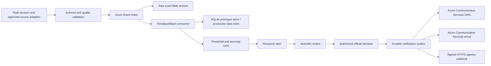

# HimalayaWatch

An early-stage AI research prototype for multi-hazard early-warning decision support across Nepal, Tibet, India, and Pakistan. HimalayaWatch connects cryosphere, river, rainfall, weather, and disaster evidence while keeping uncertainty, provenance, and human authorization visible.

> **Important:** This is not an official emergency-warning system. Seeded observations and thresholds are synthetic. Notification delivery is disabled until recipients are configured and an authorized operator approves an alert backed by validated, non-synthetic evidence. Scientists validate evidence; authorized officials decide whether and how to act.

## Quick start

Requires Python 3.10 or newer.

```powershell
python -m venv .venv
.\.venv\Scripts\Activate.ps1
python -m pip install -r requirements.txt
python -m flask --app app init-db
python -m flask --app app run
```

Open **http://127.0.0.1:5000**.

The application also initializes and seeds an empty database on first startup. To choose another database location, copy `.env.example` values into your shell environment. Flask does not load `.env` without an optional dotenv package, so set variables directly or use your preferred environment manager.

Container image:

```powershell
docker build -t himalayawatch:local .
docker run --rm -p 8000:8000 -e DATABASE_PATH=/app/instance/glacier_monitor.db himalayawatch:local
```

Open **http://127.0.0.1:8000**.

## Commands

```powershell
# Re-evaluate alerts through the built-in demo adapter
python -m flask --app app refresh-data --provider demo

# Ingest a normalized local JSON batch
python -m flask --app app ingest-source --provider json-file `
  --path .\examples\source-events.json

# Consume one bounded Event Hubs batch
python -m flask --app app consume-eventhub --max-events 100 --wait-seconds 10

# Deliver authorized pending notifications
python -m flask --app app process-notifications

# Check BIPAD and Sentinel catalog reachability without downloading products
python -m flask --app app check-discovery

# Create an empty database (use a fresh DATABASE_PATH)
python -m flask --app app init-db --no-seed

# Run tests
python -m pytest
```

A production scheduler can invoke `refresh-data` and `process-notifications` on fixed intervals. `consume-eventhub` is intended for a continuously restarted worker/job in production. Provider classes implement `ProviderAdapter.refresh(database)` in `glacier_monitor/providers.py`; normalized file/HTTPS adapters are in `glacier_monitor/source_adapters.py`.

## Included behavior

- Responsive map and catalog filters for country, asset type, and risk.
- Dedicated Glacier Imagery explorer with inventory map, rolling three-month gallery, search, country/region/glacier/date/cloud/source filters, and progressive loading.
- Retrospective 26 August 2026 Bhote Koshi–Trishuli cascading-hazard scenario with downstream corridor context and a clearly preliminary trigger assessment.
- Rasuwa/Langtang context including Yala and Langtang glaciers, documented Yala AWS metadata, and a clearly non-live Syabrubesi hydrometeorological reference point.
- Curated India coverage includes Gangotri, Siachen, Bara/Chhota Shigri, South Lhonak, Tso Moriri, Chandertal, HIMANSH, and Hanle.
- Curated Pakistan coverage includes Baltoro, Biafo, Hispar, Batura, Sheosar, Rush, Saiful Muluk, and PMD observatories at Astore, Skardu, and Hunza.
- Glacier metadata, representative change fields, observation time, source, and freshness.
- Persisted lake readings, warning/critical/rapid-rise thresholds, inline trend charts, and alert state.
- Environmental stations that distinguish **measured CO2**, **modeled CO2 proxy**, and weather observations.
- Research signals for lake/river threshold exceedance, rapid lake or river rise, stale/offline stations, and abnormal glacier movement.
- Separate observation and availability timestamps so historical evaluation does not use future knowledge.
- Explicit decision gates: `withheld`, `research_only`, and `human_review`.
- Bounded BIPAD and Sentinel discovery checks that never claim validated satellite hazard detection.
- API input validation, parameterized SQL, 64 KiB request limit, security headers, optional write API key, accessible focus/empty/error/loading states, and escaped dynamic content.
- Idempotent normalized source events with accepted/processed/rejected audit state.
- Optional Azure Event Hubs transport, Blob raw-event archive, and Blob-backed consumer checkpoints using managed identity.
- Human-authorized notification subscriptions, durable delivery outbox, parallel Azure Communication Services SMS/email delivery, signed HTTPS webhooks, bounded retries, and masked destinations.

## Event and notification architecture



The implemented slice follows the supplied diagram's ingestion, archive, rules, review, approval, audit, and communication path. Microsoft Fabric, Azure AI Search, and Foundry agents are deliberately not placed in the life-safety notification path: they can be added later for analysis, but no generative model should independently authorize an emergency message.

### Normalized source-event contract

Every adapter emits `himalayawatch` sensor events with a stable `event_id`, provider, asset slug, metric, numeric value, observation time, availability time, quality state, provenance URL, synthetic flag, and metadata. Duplicate IDs are idempotent. Events with a valid envelope identity that fail asset or reading validation are retained in `source_events` with a rejected state and explicit error.

Implemented adapters:

| Adapter | Use | Network behavior |
|---|---|---|
| `json-file` | Field-gateway export, replay, and offline transfer | Local file only; 2 MiB/1000-event bounds |
| `https-json` | Approved upstream endpoint using the normalized contract | HTTPS only, public IPs only, 2 MiB/1000-event bounds |
| Sentinel STAC | Glacier imagery metadata | Existing bounded public catalog query |

Nepal DHM, ICIMOD, Pakistan PMD, and India HIMANSH remain **field-mapping profiles to complete with provider permission and a stable machine-readable contract**. The application does not scrape their websites or invent live feeds.

Set `INGESTION_MODE=direct` for the credential-free local app. Set it to `eventhub` to make `POST /api/source-events` publish to Azure Event Hubs; run the consumer separately to archive, validate, persist, and evaluate events.

### Azure configuration

The application prefers `DefaultAzureCredential`/managed identity:

```text
INGESTION_MODE=eventhub
AZURE_EVENTHUB_NAMESPACE=<namespace>.servicebus.windows.net
AZURE_EVENTHUB_NAME=himalayawatch-events
AZURE_EVENTHUB_CONSUMER_GROUP=himalayawatch-processors
AZURE_ARCHIVE_STORAGE_ACCOUNT_URL=https://<account>.blob.core.windows.net
AZURE_CHECKPOINT_STORAGE_ACCOUNT_URL=https://<account>.blob.core.windows.net
AZURE_COMMUNICATION_ENDPOINT=https://<acs-name>.<region>.communication.azure.com
AZURE_SMS_SENDER=<provisioned sender>
AZURE_EMAIL_SENDER=DoNotReply@<verified-domain>
WRITE_API_KEY=<backward-compatible local fallback>
INGEST_API_KEY=<separate strong sensor/gateway key>
OPERATOR_API_KEY=<separate strong authorization key>
```

Connection-string variables exist only for local development. Do not store them in source control. The Azure deployment uses managed identity for Event Hubs, Storage, ACR, and Communication Services, and native Container Apps secrets for API keys and optional sender/HMAC values. It does not require Azure Key Vault. `WRITE_API_KEY` remains a backward-compatible local fallback; production should set separate ingestion and operator keys. Deployable Bicep and role guidance are under `infra/azure/`.

The current operator page accepts the operator key in-memory for prototype exercises. A
public deployment should place the app behind Microsoft Entra authentication and replace
shared operator keys with role-based identity before onboarding real recipients.

Azure SMS availability, sender types, emergency-message regulation, consent, quiet hours, language, and telecom registration vary by country. Email requires an Email Communication Services resource, a linked verified or Azure-managed domain, and an approved sender address. Configure recipients only with organizational and legal approval.

### Configure and authorize delivery

Create a recipient subscription:

```powershell
$headers = @{ "X-API-Key" = $env:OPERATOR_API_KEY }
$subscription = @{
  name = "Nepal emergency duty team"
  channel = "sms"
  destination = "+9779800000000"
  country = "Nepal"
  minimum_severity = "critical"
} | ConvertTo-Json
Invoke-RestMethod -Method Post `
  -Uri http://127.0.0.1:5000/api/notification-subscriptions `
  -Headers $headers -ContentType application/json -Body $subscription
```

Create an email list by posting one subscription per address (the Alerts page accepts
comma- or newline-separated lists and creates these entries together):

```powershell
"operations@example.org","backup@example.org" | ForEach-Object {
  $email = @{
    name = "Regional operations email"
    channel = "email"
    destination = $_
    country = "Nepal"
    minimum_severity = "critical"
  } | ConvertTo-Json
  Invoke-RestMethod -Method Post `
    -Uri http://127.0.0.1:5000/api/notification-subscriptions `
    -Headers $headers -ContentType application/json -Body $email
}
```

After scientific review, authorize an eligible alert:

```powershell
$approval = @{
  authorized_by = "National emergency duty officer"
  note = "Validated against independent river gauge and field report."
} | ConvertTo-Json
Invoke-RestMethod -Method Post `
  -Uri http://127.0.0.1:5000/api/alerts/123/authorize `
  -Headers $headers -ContentType application/json -Body $approval

python -m flask --app app process-notifications
```

All matching SMS, email, and webhook subscriptions are queued together and delivered concurrently by the notification worker. Synthetic, rejected, non-validated, or stale hazard evidence is rejected at the authorization gate (a validated sensor-stale alert is the intentional exception). Acknowledging an alert does not authorize delivery. Delivery failures remain visible and retry only up to `NOTIFICATION_MAX_ATTEMPTS`.

## API

| Method | Endpoint | Purpose |
|---|---|---|
| `GET` | `/healthz` | Lightweight application/database health probe. |
| `GET` | `/api/assets` | List assets. Filters: `country`, `asset_type`, `risk_level`, `operational_status`. |
| `GET` | `/api/assets/<slug>` | Asset details and reading history. |
| `GET` | `/api/readings?asset=<slug>&limit=100` | List readings (limit 1–500). |
| `POST` | `/api/readings` | Add a reading and evaluate rules. |
| `GET/POST` | `/api/source-events` | Inspect or submit normalized idempotent source events. |
| `GET` | `/api/alerts?acknowledged=false` | List alerts. |
| `POST` | `/api/alerts/<id>/acknowledge` | Acknowledge an alert. |
| `POST` | `/api/alerts/<id>/authorize` | Queue configured recipients after validated human review. |
| `GET/POST` | `/api/notification-subscriptions` | List masked or create SMS/webhook recipients. |
| `GET` | `/api/notification-deliveries` | Inspect durable delivery state and errors. |
| `GET` | `/api/cases` | List retrospective hazard cases and downstream locations. |
| `GET` | `/api/discovery-status` | List bounded provider discovery checks and limitations. |
| `GET` | `/api/glaciers` | Paginated glacier catalog; filters include `country`, `region`, `q`, and `bbox`. |
| `GET` | `/api/glaciers/<inventory-id>` | Glacier inventory detail and imagery count. |
| `GET` | `/api/glacier-imagery` | Rolling three-month observations; filters include date, glacier, country, region, cloud, source, bbox, limit, cursor, or page. |

Example:

```powershell
$body = @{
  asset = "imja-tsho"
  metric = "water_level_m"
  value = 4.63
  observed_at = (Get-Date).ToUniversalTime().ToString("o")
  available_at = (Get-Date).ToUniversalTime().ToString("o")
  quality_status = "provisional"
  source_url = "https://example.org/traceable-record"
  is_synthetic = $true
  metadata = @{ quality = "demo" }
} | ConvertTo-Json

Invoke-RestMethod -Method Post -Uri http://127.0.0.1:5000/api/readings `
  -ContentType application/json -Body $body
```

If `WRITE_API_KEY` is set, send it as the `X-API-Key` header on write requests. The default local demo intentionally has no credential requirement.

## Glacier inventory and imagery

The default database contains **48 deterministic demonstration glacier records** and **144 synthetic observation-metadata records** distributed across Nepal, Tibet, India, and Pakistan. IDs beginning with `HW-DEMO-` are not GLIMS or RGI identifiers. The interface displays unnamed source records by inventory ID and never invents a name. This representative catalog is **not a complete Himalayan inventory**; use the import command with a licensed GLIMS/RGI export for defensible inventory scope.

Import a licensed GLIMS/RGI-style GeoJSON export:

```powershell
python -m flask --app app import-glacier-inventory .\inventory.geojson `
  --catalog-name "Randolph Glacier Inventory" `
  --catalog-version "7.0" `
  --source-url "https://doi.org/10.5067/F6JMOVY5NAVZ" `
  --country Nepal `
  --replace
```

The importer requires stable IDs and polygon geometry. Field names are configurable with `--id-field`, `--name-field`, `--country-field`, and `--region-field`. Without `--country`, each record must carry a `country` value of `Nepal` or `Tibet`. Review the source license and boundary methodology before import; a geographic inventory is only as complete as its source and clipping procedure.

Refresh real Sentinel-2 metadata for one glacier at a time:

```powershell
python -m flask --app app refresh-imagery --provider sentinel `
  --glacier-id RGI2000-v7.0-G-... --limit 20 --max-cloud-cover 60
```

`SENTINEL_STAC_URL` defaults to the public Copernicus Data Space STAC search endpoint. The command stores catalog metadata and permitted quicklook URLs, not image binaries. Availability time records when HimalayaWatch found the item; it may be later than the provider's original publication time. `refresh-imagery --provider demo` performs no network access and regenerates deterministic records inside the current rolling window.

API dates must stay within the exact rolling three-calendar-month interval ending today. Limits are capped at 100, bounding boxes are validated and ordered as `min_lon,min_lat,max_lon,max_lat`, and pagination supports either `cursor` or `page`.

## Data sources and adapter status

Seed records link to authoritative public portals, but the default application does **not** claim live upstream integration:

| Provider | Intended use | Default status |
|---|---|---|
| [GLIMS](https://www.glims.org/glacierdata/) / [NSIDC](https://nsidc.org/data/glims) | Glacier outlines and inventories | Adapter placeholder |
| [NASA ITS_LIVE](https://its-live.jpl.nasa.gov/) | Satellite-derived glacier velocity | Adapter placeholder |
| [ICIMOD RDS](https://rds.icimod.org/) | Regional cryosphere datasets | Adapter placeholder |
| [Nepal DHM](https://www.dhm.gov.np/) | Hydrology and meteorology | Adapter placeholder |
| [India NCPOR HIMANSH](https://www.ncpor.res.in/pages/view/115/426-himansh) / [ISRO VEDAS](https://vedas.sac.gov.in/en/Himalayan_Glacier_Inventory_Atlas.html) | Indian glacier research and inventory context | Curated metadata; no live feed |
| [Pakistan PMD](https://www.pmd.gov.pk/Observatories/) | Pakistan mountain observatory metadata | Curated metadata; no live feed |
| [Nepal BIPAD API](https://bipadportal.gov.np/api/) | Disaster incident and alert record discovery | Bounded discovery metadata only |
| [Copernicus Data Space](https://dataspace.copernicus.eu/) / Sentinel | Earth observation imagery | Adapter placeholder |
| [NOAA GML](https://gml.noaa.gov/ccgg/) and [CAMS](https://ads.atmosphere.copernicus.eu/) | Measured atmospheric records and modeled products | Adapter placeholder |

These sources have different access methods, licenses, latency, spatial coverage, and quality-control requirements. Some downloads may require registration or a service-specific token even though the source is public. An implementation must preserve provenance, measurement-vs-model labels, upstream timestamps, quality flags, and licenses.

## Limitations

- Satellite latency can range from hours to weeks due to revisit timing, clouds, processing, and product publication.
- Optical imagery can confuse cloud, terrain shadow, and seasonal snow with surface change; metadata alone does not predict a hazard.
- Thumbnail/quicklook availability varies and is not equivalent to an analysis-ready Sentinel product.
- Tibet catalog and imagery availability may vary by source, date, boundary interpretation, and access policy.
- Transboundary and high-altitude ground telemetry is sparse and may not be continuously public.
- A satellite-derived or modeled CO2 estimate is not equivalent to direct, calibrated in-situ measurement.
- Catalog geometry, area, and representative trends must be refreshed and quality-controlled before analytical use.
- The bundled four-region catalog is representative, not exhaustive. National boundaries, inventory versions, and the definition of the Himalayan region differ among sources.
- Demonstration thresholds are not official engineering, flood-warning, or evacuation criteria.
- Movement alone is not evidence of impending collapse, and missing evidence is never presented as evidence of safety.
- The 26 August 2026 reference case uses a supplied preliminary ICIMOD assessment; trigger causation and climate attribution require independent investigation.
